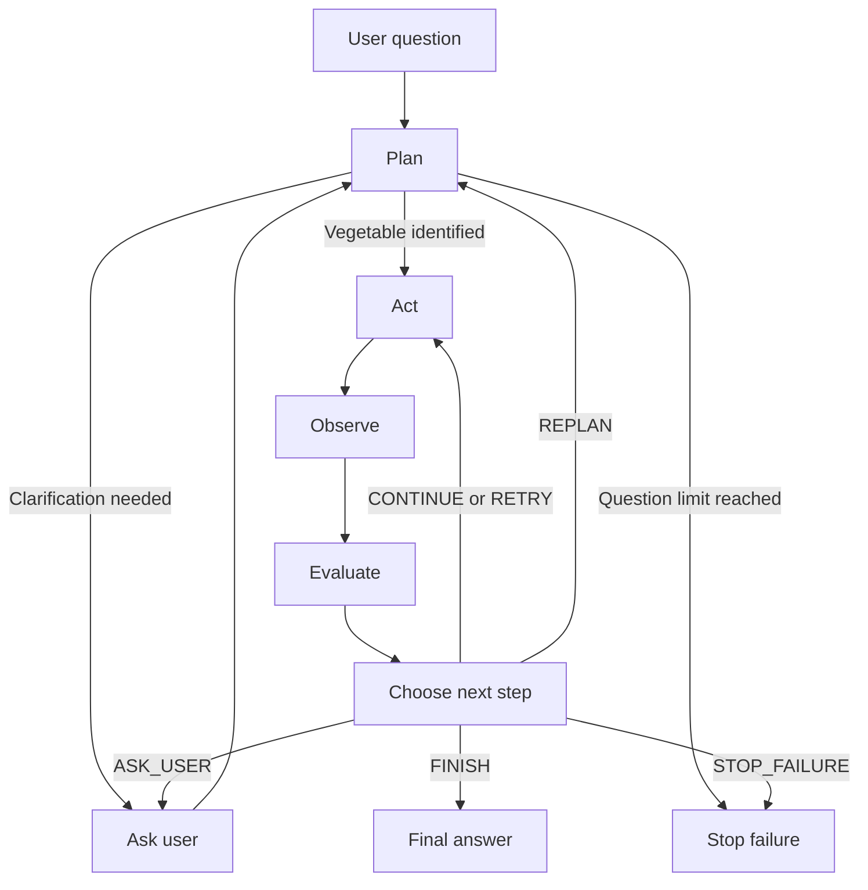

# Vegetable Assistant Agent

A beginner-friendly command-line agent built with **LangGraph**, **LangChain**, and **Ollama**.

The agent answers questions about vegetable properties and dishes using three information sources in order:

1. **Local database** — searches `vegetables.csv`.
2. **Internet search** — searches DuckDuckGo and uses the language model to analyze the results.
3. **Model knowledge** — asks the local model when the other sources do not provide an answer.

The agent prints its actions, observations, and routing decisions, and includes the information source in the final answer.

> The dataset also includes ingredients such as ginger and cinnamon, so the agent can handle some herbs and spices as well.

## Features

- Searches the local CSV before using external sources.
- Handles missing properties and dishes independently.
- Uses internet search only for information still missing.
- Analyzes search results instead of returning raw search text as the answer.
- Falls back to the model's general knowledge.
- Retries failed tool calls and unsuccessful searches.
- Attempts to correct similar vegetable names.
- Asks the user for clarification when needed.
- Displays a source label for each answer.
- Runs the language model locally through Ollama.

## Technology Stack

| Component | Purpose |
|-----------|---------|
| Python | Application logic and command-line interface |
| LangGraph | Stateful workflow and conditional routing |
| LangChain | Model messages and search-tool integration |
| Ollama | Local language-model runtime |
| Qwen 2.5 3B | Vegetable extraction, search analysis, and fallback answers |
| pandas | Reading and querying the CSV dataset |
| DuckDuckGo | Internet search |

## Project Structure

```text
.
├── vegtable_table.py
├── vegetables.csv
├── requirements.txt
└── README.md
```

> The Python filename is `vegtable_table.py`, matching the supplied project file.

## Requirements

- Python 3.10 or newer; Python 3.11 is a practical choice.
- [Ollama](https://ollama.com/) installed and running.
- The `qwen2.5:3b` model downloaded in Ollama.
- Internet access for package installation, model download, and web searches.

No paid LLM API key is required for the provided configuration.

## Installation

### 1. Clone the repository

Replace the placeholder URL with your repository URL:

```bash
git clone https://github.com/YOUR_USERNAME/YOUR_REPOSITORY.git
cd YOUR_REPOSITORY
```

### 2. Create a virtual environment

```bash
python -m venv .venv
```

Activate it:

**macOS / Linux**

```bash
source .venv/bin/activate
```

**Windows PowerShell**

```powershell
.\.venv\Scripts\Activate.ps1
```

### 3. Install dependencies

```bash
python -m pip install --upgrade pip
python -m pip install -r requirements.txt
```

The supplied `requirements.txt` contains:

```text
langchain
langchain-core
langchain-community
langchain-ollama
langgraph
pandas
ddgs
duckduckgo-search
```

### 4. Download the local model

```bash
ollama pull qwen2.5:3b
```

Make sure Ollama is running. If it is not already running through the desktop application or a background service, start it with:

```bash
ollama serve
```

You can check the installed models with:

```bash
ollama list
```

### 5. Check the CSV file

Place `vegetables.csv` in the project directory. It must be a real CSV file with these headers:

```csv
Vegetable,Property,Dish
Onion,Contains antioxidants,
Carrot,Rich in beta-carotene,
Green Pepper,,Stuffed Green Peppers
Garlic,Contains sulfur compounds,Garlic Bread
Ginger,,Ginger Chicken
Cinnamon,Contains aromatic plant compounds,Cinnamon Rolls
Potato,Provides carbohydrates and potassium,Mashed Potatoes
Tomato,Contains lycopene,Tomato Soup
Spinach,,
Broccoli,,Broccoli Soup
Cauliflower,,Roasted Cauliflower
Cabbage,Provides fiber and vitamin K,Cabbage Rolls
Cucumber,Has a high water content,
Eggplant,Provides dietary fiber,Eggplant Parmesan
Zucchini,,
Celery,,Celery Soup
Lettuce,Provides vitamin K,Lettuce Salad
Beetroot,Contains folate and dietary nitrates,Beetroot Salad
Radish,,Radish Salad
Green Peas,,Pea Soup
```

Empty cells are treated as missing information.

If you edit the dataset, quote any cell containing a comma.

## Usage

Run the application from the project directory:

```bash
python vegtable_table.py
```

Example questions:

```text
What is one health property of garlic?
Name a dish made with tomato.
Tell me about carrot.
What are the benefits of spinach?
What can I cook with green pepper?
```

Type `exit`, `quit`, or `q` at the main prompt to close the application.

### Example Answer

For:

```text
Customer: Tell me about garlic.
```

The final answer includes:

```text
Here is what I found about Garlic:
  - Property: Contains sulfur compounds
      Source: Local database (vegetables.csv)
  - Dish: Garlic Bread
      Source: Local database (vegetables.csv)

Sources used: Local database (vegetables.csv)
```

The application also prints workflow logs before the final answer.

## How It Works

### 1. Plan

The agent identifies a vegetable using:

- Case-insensitive matching against database names.
- Model-based extraction if no database name matches.

It then determines whether the question requests:

- A property.
- A dish.
- Both, when the request is ambiguous or mentions both categories.

### 2. Act

The agent runs the current source step:

```text
search_database → search_internet → use_model_knowledge
```

Only missing fields are requested from subsequent sources.

For example, if the CSV contains a carrot property but no dish, the agent keeps the property and searches online only for a dish.

### 3. Observe

The agent records new answers and their source labels.

For internet results, it also prints:

- A short preview of the search text.
- Whether the model considered the results relevant.
- Extracted key facts.
- The model's conclusion.

### 4. Evaluate

The agent checks whether the requested information has been found and selects the next action.

| Decision | Meaning |
|----------|---------|
| `CONTINUE` | Move to the next information source |
| `RETRY` | Repeat the current step |
| `REPLAN` | Restart the plan with a similar database name |
| `ASK_USER` | Request clarification |
| `FINISH` | Return a complete or partial answer |
| `STOP_FAILURE` | Stop when no useful answer can be found |

### 5. Finish

The final answer lists the requested fields and their sources. If only part of the request could be answered, the missing field is reported explicitly.

## Workflow



## Code Overview

| Section | Responsibility |
|---------|----------------|
| Configuration | Defines the model, source order, keywords, and retry limits |
| Initialization | Loads the CSV, Ollama model, and search tool |
| Helper functions | Extract names, detect requested fields, and parse search analysis |
| Tool functions | Retrieve information from the database, internet, or model |
| `AgentState` | Stores the question, plan, results, sources, and counters |
| Agent nodes | Implement planning, actions, observation, evaluation, and completion |
| Routing functions | Select the next graph node |
| Graph construction | Connect nodes and compile the LangGraph workflow |
| `main()` | Runs the interactive command-line loop |

The workflow uses predefined Python routing rules. The model helps interpret text and generate answers, but it does not freely choose arbitrary tools or create new plan steps.

## Configuration

Edit these values in `vegtable_table.py`:

```python
CSV_PATH = "vegetables.csv"
MODEL_NAME = "qwen2.5:3b"

MAX_RETRIES = 1
MAX_REPLANS = 1
MAX_QUESTIONS_TO_USER = 2
```

- `MAX_RETRIES`: Number of additional attempts for the current source step.
- `MAX_REPLANS`: Maximum number of similar-name replans.
- `MAX_QUESTIONS_TO_USER`: Maximum number of clarification questions per request.

To use another Ollama model, download it and update `MODEL_NAME`:

```bash
ollama pull YOUR_MODEL_NAME
```

## Current Limitations

- **One vegetable per request:** Multiple vegetables are not processed independently.
- **One answer per field:** Requests such as “give me two dishes” still produce a single dish field.
- **No combined-recipe planning:** The application does not create a structured recipe from multiple ingredients.
- **English-oriented parsing:** Request detection uses English keywords.
- **No persistent conversation memory:** Each main-loop question starts with a fresh state.
- **No automatic database updates:** Retrieved answers are not written back to the CSV.
- **Source labels, not citations:** Internet answers do not include structured article URLs or verified citations.
- **Model analysis is not verification:** The model may misunderstand search results or generate inaccurate claims.
- **Simple name matching:** Substring matching and fuzzy matching can occasionally select an unintended ingredient.
- **Search availability varies:** Network failures, rate limits, and package changes can affect DuckDuckGo search.

The local model can provide fallback answers without internet access, but online search still requires a connection.

## Troubleshooting

### `vegetables.csv` cannot be found

Run the application from the directory containing the CSV, or change `CSV_PATH` to the correct path.

### CSV column errors

The file must contain these exact column names:

```text
Vegetable
Property
Dish
```

Leading and trailing spaces in headers are removed, but capitalization still matters.

### Cannot connect to Ollama

Start Ollama and confirm that the model is installed:

```bash
ollama serve
ollama list
```

### Model not found

Download the configured model:

```bash
ollama pull qwen2.5:3b
```

### DuckDuckGo search fails

Check your internet connection and dependency compatibility. The agent normally retries the search and then falls back to model knowledge if information is still missing.

### Graph recursion limit reached

The application currently uses:

```python
config={"recursion_limit": 50}
```

This limits graph execution steps, not Python function recursion. If you increase retry or clarification limits, you may also need to increase this graph limit.

## Possible Improvements

- Support multiple vegetables in one request.
- Return a requested number of properties or dishes.
- Suggest dishes using several ingredients together.
- Include article URLs and stronger source validation.
- Use structured model output instead of parsing formatted text.
- Add automated tests and pin dependency versions.
- Add a web interface.
- Make memory or caching optional.

## Nutrition Disclaimer

This project provides general food and nutrition information for educational purposes. Answers may be incomplete or inaccurate and should not replace advice from a qualified healthcare professional.
